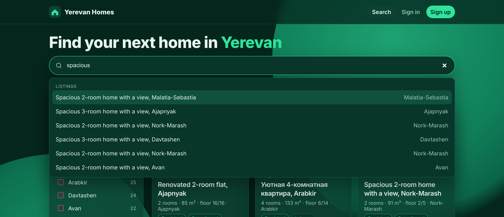
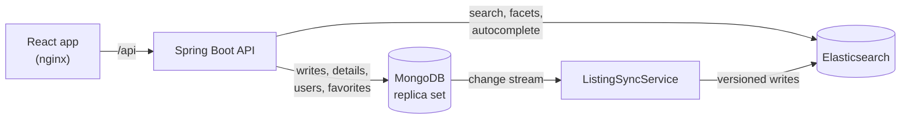

# Yerevan Homes

[](https://github.com/YurHarutyunyan/arm_estate/actions/workflows/ci.yml)

A rental search platform for Yerevan: full-text search in English, Russian and Armenian with typo
tolerance, live facet counts, owner accounts that publish listings, and favorites.

**Stack:** Java 21 · Spring Boot 4 · MongoDB 9 · Elasticsearch 9 · React 19 + TypeScript · Docker ·
Testcontainers · Playwright · GitHub Actions


<p>
  
  
</p>

## Run it

```bash
docker compose up --build
```

Open <http://localhost:3000>. On first start the backend seeds 300 realistic listings.
API docs: <http://localhost:3000/swagger-ui.html>.

## Architecture



MongoDB is the source of truth. A change stream copies every insert, update and delete into
Elasticsearch, which serves all search traffic.

## Engineering highlights

### Keeping search in sync without losing or reordering updates

- **Resumable.** The change stream's resume token is stored after every event, so a restart
  continues exactly where it stopped.
- **No gap on first start.** The stream is opened *before* the full reindex, so writes that happen
  during the reindex are replayed afterwards.
- **Order-safe.** Every Elasticsearch write uses external versioning from the MongoDB document
  version. A late or replayed event can't overwrite newer data, and deletes leave a versioned
  tombstone, so a stale re-insert can't bring a deleted listing back. The deleted version comes from
  change stream pre-images.
- **Self-healing.** If the resume token becomes unusable (history rolled over, collection dropped),
  the index is rebuilt automatically.

### Concurrency

- **Optimistic locking over HTTP.** Listings carry their version as an `ETag`; `PUT` and `DELETE`
  require `If-Match`. Two people editing the same listing can't silently overwrite each other: the
  second gets `412`, and the UI offers to load the latest version. Missing `If-Match` returns `428`.
- **Atomic favorites.** Adding and removing use single `$addToSet` / `$pull` updates. The
  200-favorite limit is part of the update's query, so parallel requests can't exceed it.
- **Race-safe sign-up.** A unique index, not an "exists?" check, decides between parallel sign-ups
  with the same email.

### Search

- English, Russian and Armenian analyzers on every text field, queried together.
- `fuzziness: AUTO` for typos ("balkony" finds "balcony"), title and phrase boosts, and a recency
  boost through a gauss decay.
- **Facets that stay useful:** filters run as `post_filter`, and each facet applies every filter
  except its own. With Kentron selected you still see how many homes the other districts have.
- **Stable deep paging** with `search_after` and an id tiebreaker, behind an opaque cursor tied to its
  sort order.
- Autocomplete on a `search_as_you_type` field; highlights are HTML-escaped by Elasticsearch.

### Security

- Stateless JWT (HS256) with `USER`, `OWNER` and `ADMIN` roles; owners can only change their own
  listings. Nobody can sign up as admin.
- Login answers wrong passwords and unknown emails identically, and compares against a dummy hash
  so both take the same time.
- Failed logins are limited per account (10 per 15 minutes, then `429` with `Retry-After`).
- BCrypt (cost 12); the 72-byte input limit is checked in bytes, not characters, since 40 Armenian
  letters are already 80 bytes. Errors are RFC 9457 problem details.
- nginx sends a strict Content-Security-Policy and other security headers.

## Tests

| Suite | What it covers | Run |
|---|---|---|
| Backend (JUnit 5 + Testcontainers) | 53 tests against real MongoDB and Elasticsearch: sync ordering and recovery (including a lost search index), racing editors, parallel favorites and sign-ups, search relevance, typos, the three languages, facets, paging | `cd backend && ./mvnw verify` |
| End-to-end (Playwright) | 35 tests through the real UI and API on desktop and a 375px phone: search, filters, sorting, three languages, accounts, favorites, owner permissions, edit conflicts, security headers. Role-based locators | `docker compose up -d --build --wait && cd e2e && npm ci && npx playwright test` |

Bugs caught before release:
- **nginx gzip turned strong ETags weak** (`"0"` became `W/"0"`), which made every edit fail. Found by
  the end-to-end suite.
- **nginx dropped the security headers from every page**: an `add_header` inside a `location` block silently replaces the server-level ones. Found in review; now covered by an end-to-end test.
- **A blur filter on the background shapes** forced a full repaint on every animation frame.
- **MongoDB 8 refuses to start on Linux kernels 6.19+** (SERVER-121912), which CI runners now use;
  the project runs on MongoDB 9.

## Configuration

| Variable | Purpose |
|---|---|
| `APP_JWT_SECRET` | Signing key, at least 32 bytes. **Required in production.** |
| `APP_JWT_TTL` | Token lifetime, default `PT2H` |
| `APP_ADMIN_EMAIL`, `APP_ADMIN_PASSWORD` | Creates an admin account on startup |
| `APP_SEED_ENABLED` | Seeds demo data into an empty database |
| `APP_LOGIN_MAX_FAILURES`, `APP_LOGIN_WINDOW` | Login limit, default 10 per `PT15M` |
| `MONGODB_URI`, `ELASTICSEARCH_URIS` | Data stores |

## Project layout

```
backend/    Spring Boot API (listing, search, auth, user, seed packages)
frontend/   React + TypeScript, served by nginx in production
e2e/        Playwright tests
PLAN.md     Design notes and decisions
```
